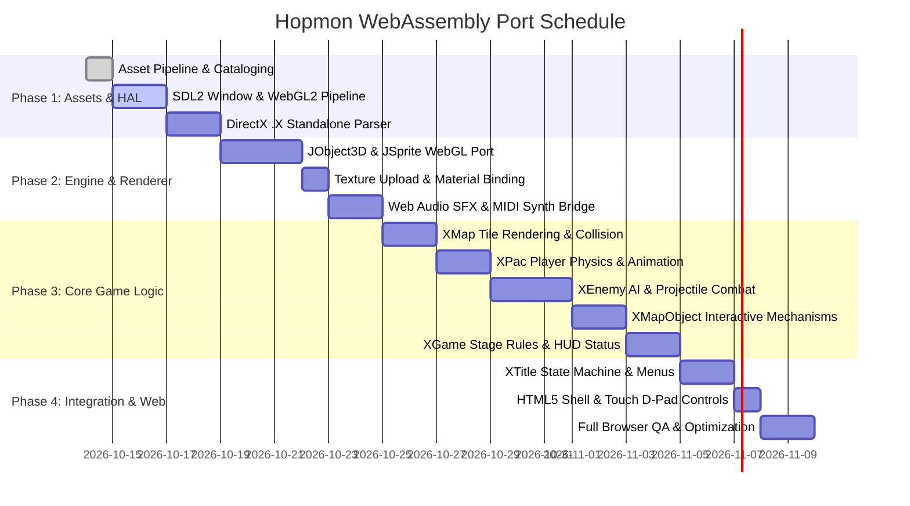

# Hopmon C++ to WebAssembly Port Plan

**Target**: *Hopmon* (JJ Soft, 2002)  
**Source Artifacts**: `Hopmon.exe` (PE32 x86), `Hopmon.pdb` (MSVC 7.0 debug symbols)  
**Target Architecture**: C++17 $\to$ WebAssembly (Wasm) via Emscripten, SDL2, and WebGL 2.0  
**Target Environment**: Desktop & Mobile Web Browsers (Chrome, Firefox, Safari, Edge)

---

## 1. Executive Summary & Goals

*Hopmon* is a 3D grid-based arcade action game developed in 2002 by JJ Soft. The original game was written in C++ using the Microsoft DirectX 7 SDK sample framework (`CD3DApplication`), Direct3D 7 fixed-function rendering, DirectDraw 7, DirectInput, and DirectSound.

Through reverse engineering and symbol extraction from `Hopmon.pdb`, 100% of the game's code has been decompiled into 29 structured C++ modules (900 functions, 830 KB of source), and all 27 3D meshes, 43 textures, 18 sound effects, and 4 MIDI tracks have been extracted.

### Primary Objectives
1. **Replace Legacy Windows/DirectX 7 APIs** (~30% of codebase) with a modern, portable Hardware Abstraction Layer (HAL) built on **SDL2**, **WebGL 2.0**, and the **Web Audio API**.
2. **Refactor Decompiled C++ Logic** (~70% of codebase) into standard **C++17**, removing MSVC compiler intrinsics, Win32 handle types, and structured exception handling.
3. **Compile to WebAssembly (Wasm)** via **Emscripten** (`emcc`) with preloaded assets, creating a single self-contained web game running at 60 FPS in modern browsers.
4. **Preserve Original Gameplay & Aesthetics**: Maintain exact 1:1 player physics, grid movement, enemy AI behavior, animation keyframes, sound effects, and MIDI music tracks.

---

## 2. Codebase & Subsystem Inventory

The project consists of 29 modules categorized into three layers:

```
+-----------------------------------------------------------------------------------+
|                            GAMEPLAY LAYER (414 Funcs)                             |
|  XAppMain | XTitle | XGame | XMap | XMapObject | XPac | XEnemy | XChara | XRegister |
+-----------------------------------------------------------------------------------+
|                             ENGINE UTILITIES (289 Funcs)                          |
|  JObject3D | JSprite | JSound | JMidi | JDinput | JSurface | JString | JList ...  |
+-----------------------------------------------------------------------------------+
|                        PLATFORM ABSTRACTION LAYER (HAL)                           |
|       SDL2 Window/Events | WebGL 2.0 Renderer | Web Audio Engine | localStorage   |
+-----------------------------------------------------------------------------------+
```

### Module Classification & Porting Action Table

| Module | Funcs | Original Responsibility | Porting Strategy |
| :--- | :---: | :--- | :--- |
| **`XAppMain`** | 29 | `WinMain`, window pump, D3D lifecycle | Replace with SDL2 main loop & `emscripten_set_main_loop`. |
| **`XTitle`** | 32 | Title state machine, logo animation, stage select | Clean types; connect to input and stage loader. |
| **`XRegister`** | 8 | Shareware dialog & license verification | Stub out `IsRegistered()` to always return `true` (full game unlocked). |
| **`XGame`** | 23 | Game session loop, stage progression, camera | Clean Win32 types; bind to renderer and HUD. |
| **`XMap`** | 53 | 3D grid tile map, block collisions, preview map | Retain logic 100%; connect tile mesh drawing to WebGL. |
| **`XMapObject`** | 42 | Interactive objects (cannons, gates, traps) | Retain state machines and projectile spawn callbacks. |
| **`XPac`** | 37 | Protagonist physics, movement, weapons, health | Retain rotation, grid snapping, and firing logic. |
| **`XEnemy`** | 91 | 8 enemy archetypes, AI state machines, attacks | Retain AI update routines, projectile triggers, collision checks. |
| **`XChara`** | 99 | 3D mesh rendering, animations, crystals, particles | Retain particle emitters and animation frame counters. |
| **`JObject3D`** | 82 | 3D object hierarchy, planar shadows, billboarding | Port to modern WebGL mesh/matrix transformation engine. |
| **`JSprite`** | 27 | 2D HUD sprite rendering | Port to 2D orthographic WebGL quad renderer. |
| **`JSound`** | 23 | DirectSound audio playback & 3D panning | Map to Web Audio API / OpenAL buffer playback. |
| **`JMidi`** | 14 | DirectMusic / WinMM MIDI playback | Route to Web Audio SoundFont synthesizer bridge. |
| **`JDinput`** | 24 | DirectInput keyboard/mouse polling | Map to SDL2 keyboard & touch event state array. |
| **`JSurface`** | 24 | DirectDraw surface & texture management | Map to WebGL texture uploads (`glTexImage2D`). |
| **`JString` / `List`** | 45 | Custom string & list containers | Retain or map to `std::string` and `std::vector`. |
| **`JWinReg`** | 17 | Windows Registry persistence | Map to browser `localStorage` JSON serialization. |
| **`JAscii`** | 13 | Bitmap font text renderer | Draw text quads using font atlas texture. |
| **`JStandard`** | 7 | Memory & math utilities | Replace with standard C++17 `<cmath>` and `<cstring>`. |
| **`d3dapp`** | 55 | `CD3DApplication` framework | **Replace** with `WebPlatform::Window` (SDL2). |
| **`d3dfile`** | 53 | DirectX `.X` file parser | **Replace** with standalone text/binary `.X` mesh loader. |
| **`d3dframe`** | 18 | D3D frame hierarchy matrices | **Replace** with lightweight GLM / C++ matrix hierarchy. |
| **`d3dmath`** | 15 | D3D vector and matrix math | **Replace** with modern vector/matrix math library. |
| **`d3dtextr`** | 21 | DirectDraw texture cache | **Replace** with WebGL texture manager. |
| **`d3dutil`** | 15 | D3D utility helper routines | Replace with WebGL helpers. |
| **`ddutil`** | 6 | DirectDraw surface creation & blits | Replace with WebGL framebuffer/blit operations. |
| **`d3denum`** | 14 | Direct3D device/driver enumeration | **Omit** (fixed to WebGL canvas context). |

---

## 3. Platform Abstraction Layer (HAL) Architecture

The Platform Abstraction Layer bridges the game engine to browser APIs via SDL2 and Emscripten:

```
+---------------------------------------------------------------------------+
|                          WebPlatform HAL Interface                         |
+---------------------+---------------------+-------------------------------+
|     GfxDevice       |     AudioDevice     |         InputDevice           |
+---------------------+---------------------+-------------------------------+
| - Init(canvas, w, h)| - LoadSFX(id, path) | - PollEvents()                |
| - BeginScene()      | - PlaySFX(id, pan)  | - IsKeyDown(key)              |
| - SetTransform(...) | - PlayBGM(track_id) | - GetMousePos(x, y)           |
| - SetMaterial(...)  | - StopBGM()         | - SetVirtualDPad(dx, dy, btn) |
| - DrawMesh(vbo)     | - SetVolume(sfx,bgm)|                               |
| - EndScene()        |                     |                               |
+---------------------+---------------------+-------------------------------+
```

### 3.1 Graphics Subsystem: WebGL 2.0 Direct3D 7 Emulator

Direct3D 7 uses fixed-function pipeline state. We emulate this through a single WebGL 2 shader program with uniform buffers:

#### Vertex Shader (`shaders/d3d_fixed.vert`)
```glsl
#version 300 es
layout(location = 0) in vec3 aPosition;
layout(location = 1) in vec3 aNormal;
layout(location = 2) in vec2 aTexCoord;
layout(location = 3) in vec4 aColor;

uniform mat4 uWorld;
uniform mat4 uView;
uniform mat4 uProjection;

uniform vec3 uLightDir;       // Directional sun light
uniform vec4 uLightDiffuse;   // Light color
uniform vec4 uAmbientLight;   // Scene ambient color
uniform vec4 uMaterialDiffuse;

out vec2 vTexCoord;
out vec4 vColor;

void main() {
    mat4 modelView = uView * uWorld;
    gl_Position = uProjection * modelView * vec4(aPosition, 1.0);
    
    // Normal transform
    mat3 normalMatrix = transpose(inverse(mat3(uWorld)));
    vec3 N = normalize(normalMatrix * aNormal);
    vec3 L = normalize(-uLightDir);
    
    // N dot L diffuse
    float nDotL = max(dot(N, L), 0.0);
    vec4 diffuse = uMaterialDiffuse * uLightDiffuse * nDotL;
    
    vColor = (uAmbientLight + diffuse) * aColor;
    vTexCoord = aTexCoord;
}
```

#### Fragment Shader (`shaders/d3d_fixed.frag`)
```glsl
#version 300 es
precision mediump float;

in vec2 vTexCoord;
in vec4 vColor;

uniform sampler2D uTexture;
uniform bool uUseTexture;
uniform bool uAlphaTest;
uniform float uAlphaRef;

out vec4 fragColor;

void main() {
    vec4 texColor = uUseTexture ? texture(uTexture, vTexCoord) : vec4(1.0);
    vec4 finalColor = texColor * vColor;
    
    // Direct3D 7 ALPHATESTENABLE emulation (used for shadows, trees, particles)
    if (uAlphaTest && finalColor.a < uAlphaRef) {
        discard;
    }
    
    fragColor = finalColor;
}
```

### 3.2 Audio Subsystem: Web Audio API & SoundFont MIDI

1. **Sound Effects (`assets/audio/sfx_*.wav`)**:
   - 18 WAV files preloaded into Emscripten virtual file system.
   - Decoded at startup into standard OpenAL / Web Audio PCM buffers.
   - Panned playback: calculates audio pan and attenuation based on distance from player Hopmon.
2. **Background Music (`assets/music/Music01.mid` – `Music04.mid`)**:
   - Web Audio MIDI synthesizer (`spessasynth_lib` or HTML5 Audio bridge) embedded in the HTML harness.
   - Communicates with C++ via Emscripten JS library (`EM_JS` / `EM_ASM`):
     ```cpp
     EM_JS(void, WebAudio_PlayBGM, (int trackId), {
         window.HopmonAudio.playBGM(trackId);
     });
     ```

### 3.3 Input Subsystem

Maps HTML5 keyboard, touch, and gamepad events to the original game's keys:

| Action | Primary Key | Secondary Key | Gamepad | Mobile Touch |
| :--- | :--- | :--- | :--- | :--- |
| **Move Forward** | `Up Arrow` | `W` | D-Pad Up / L-Stick | Virtual D-Pad Up |
| **Move Backward** | `Down Arrow` | `S` | D-Pad Down / L-Stick | Virtual D-Pad Down |
| **Move Left** | `Left Arrow` | `A` | D-Pad Left / L-Stick | Virtual D-Pad Left |
| **Move Right** | `Right Arrow` | `D` | D-Pad Right / L-Stick | Virtual D-Pad Right |
| **Fire Projectile** | `Spacebar` | `Z` / `J` | Button A (Cross) | Red Action Button |
| **Pause / Menu** | `Escape` | `P` | Start / Options | Pause Icon |
| **Confirm / Select** | `Enter` | `Spacebar` | Button A | Tap Screen |

### 3.4 Save Data & Persistence (`JWinReg` Replacement)

The original game wrote progress to Windows registry `HKCU\Software\JJsoft\Hopmon`:
- `Level`: Highest unlocked stage (1 to 45).
- `HighScores`: Best scores per world.
- `Config`: Volume, full-screen, control settings.

**Replacement Implementation**:
- Serialize state as a JSON object:
  ```json
  {
    "maxLevel": 45,
    "currentLevel": 1,
    "soundVolume": 80,
    "musicVolume": 70,
    "highScores": [125000, 98000, 74000]
  }
  ```
- Store directly in browser `window.localStorage.getItem('hopmon_save')` via Emscripten JS helper.

---

## 4. DirectX `.X` 3D Mesh Parser & Animation Pipeline

Hopmon uses 27 models stored in DirectX `.X` format (`xof 0303txt 0032` text format and `xof 0302bin 0064` binary format).

### Mesh File Layout

Each `.X` file contains:
1. `Header { 1; 0; 1; }`
2. `Mesh <Name> {`
   - Vertex count $N$, followed by $N$ 3D coordinates `(x, y, z)`.
   - Face count $F$, followed by $F$ polygon indices (triangles / quads).
   - `MeshNormals { ... }`: Normal vectors per face/vertex.
   - `MeshTextureCoords { ... }`: UV coordinates $(u, v)$ per vertex.
   - `MeshMaterialList { ... }`: Texture filename references or RGBA colors.
3. `}`

### Standalone Parser Implementation (`CD3DFile` Replacement)
A lightweight standalone C++ parser reads `.X` files without DirectX SDK or COM dependencies:
```cpp
struct Vertex {
    float x, y, z;
    float nx, ny, nz;
    float u, v;
    uint32_t color;
};

struct Mesh {
    std::vector<Vertex> vertices;
    std::vector<uint16_t> indices;
    uint32_t textureId;
    GLuint vbo;
    GLuint ibo;
};
```

### Character Keyframe Animation (`JObject3DX`)
Hopmon characters are animated by swapping mesh frames or interpolating keyframe models:
- **`Pac_1.x`** (Idle stance)
- **`Pac_2.x`** (Left foot forward, mouth slightly open)
- **`Pac_3.x`** (Right foot forward, rolling motion)
- **`Pac_4.x`** (Flattened death / stage clear pose)

The animation controller (`JObject3DX::SetCurrentFrame`) selects the active vertex buffer based on `frameCount % walkCycleSpeed`.

---

## 5. Game Logic & Math Refactoring Plan

### 5.1 Type & Signature Normalization

Search and replace Windows-specific macros and conventions across all 21 game modules:

```cpp
// Before (Decompiled 2002 Win32)
undefined4 __thiscall XPac::ProcessFrame(void) {
    DWORD dwTime = timeGetTime();
    ...
}

// After (Modern C++17)
void XPac::ProcessFrame(uint32_t frameCount) {
    uint32_t dwTime = frameCount * 16; // 60 FPS deterministic tick
    ...
}
```

- Strip Ghidra artifacts (`ExceptionList`, `puStack_*`, security cookie injections).
- Convert all `undefined4` and `int` return codes to proper enum/boolean values.
- Replace raw pointer arithmetic (`*(float*)(in_ECX + 0x10)`) with typed struct member accesses (`this->pos.z`).

### 5.2 3D Grid Coordinate & Collision System (`XMap`)

Hopmon uses an integer-cell grid with continuous floating-point character positions:
- Grid cell size: 40.0 units $\times$ 40.0 units.
- Position conversion:
  ```cpp
  int mapX = static_cast<int>(floor((worldX + 20.0f) / 40.0f));
  int mapZ = static_cast<int>(floor((worldZ + 20.0f) / 40.0f));
  ```
- Tile Types:
  - `0`: Pit / Empty Space (falling hazard).
  - `1`: Normal Walkable Floor.
  - `2`: Wall / Obstacle (blocks movement and projectiles).
  - `3`: Ice Floor (causes inertia / character continues sliding).
  - `4`–`7`: Conveyor Belts (moves entity in Cardinal direction: N, E, S, W).
  - `8`: Exit Portal (activates once all crystals are collected).

---

## 6. Directory Layout & Build Architecture

### 6.1 Proposed Repository Tree

```
hopmon-wasm/
├── CMakeLists.txt                # CMake build configuration for native & Emscripten
├── Makefile                      # Quick build targets (web, native, serve)
├── assets/                       # Extracted & normalized game assets
│   ├── models/                   # 27 .X 3D meshes (Pac_1.x, etc.)
│   ├── textures/                 # 43 .bmp textures
│   ├── audio/                    # 18 .wav sound effects
│   ├── music/                    # 4 .mid background music tracks
│   └── manifest.json             # Resource ID to filename dictionary
├── include/                      # Reconstructed C++ headers
│   ├── XAppMain.h
│   ├── XTitle.h
│   ├── XGame.h
│   ├── XPac.h
│   ├── XMap.h
│   ├── XMapObject.h
│   ├── XEnemy.h
│   ├── XChara.h
│   ├── JObject3D.h
│   ├── JSprite.h
│   ├── JSound.h
│   └── ...
├── src/                          # Cleaned C++17 game logic
│   ├── XAppMain.cpp
│   ├── XTitle.cpp
│   ├── XGame.cpp
│   ├── XPac.cpp
│   ├── XMap.cpp
│   ├── XMapObject.cpp
│   ├── XEnemy.cpp
│   ├── XChara.cpp
│   ├── JObject3D.cpp
│   ├── JSprite.cpp
│   └── ...
├── hal/                          # Platform Abstraction Layer (SDL2 / WebGL)
│   ├── GfxDevice.h / .cpp        # WebGL 2 / OpenGL renderer & shader management
│   ├── AudioDevice.h / .cpp      # Web Audio / OpenAL sound manager
│   ├── InputDevice.h / .cpp      # Keyboard, mouse, touch controller
│   ├── XFileParser.h / .cpp      # Standalone DirectX .X mesh loader
│   └── Storage.h / .cpp          # localStorage / JSON save system
└── web/                          # Browser deployment artifacts
    ├── index.html                # Responsive canvas shell & mobile controls
    ├── style.css                 # Retro arcade layout & touch D-Pad
    ├── midi_synth.js             # Web Audio SoundFont MIDI player bridge
    └── favicon.ico               # Game icon
```

### 6.2 Emscripten Build Configuration

```bash
emcc \
  -std=c++17 \
  -O3 \
  -flto \
  src/*.cpp \
  hal/*.cpp \
  -Iinclude/ \
  -Ihal/ \
  -sUSE_SDL=2 \
  -sUSE_WEBGL2=1 \
  -sINITIAL_MEMORY=64MB \
  -sALLOW_MEMORY_GROWTH=1 \
  -sFORCE_FILESYSTEM=1 \
  --preload-file assets/@/assets/ \
  --shell-file web/index.html \
  -sEXPORTED_RUNTIME_METHODS='["ccall", "cwrap"]' \
  -o web/hopmon.html
```

---

## 7. Phased Implementation Roadmap



### Phase Breakdown

#### Phase 1: Platform Foundation & Asset Loading (Days 1–3)
- [x] Extract all 27 `.x` meshes, 43 `.bmp` textures, 18 `.wav` sound clips, and 4 `.mid` tracks.
- [ ] Implement `hal/GfxDevice.cpp`: Initialize SDL2 window and WebGL 2.0 context. Compile `d3d_fixed.vert` and `d3d_fixed.frag`.
- [ ] Implement `hal/XFileParser.cpp`: Load vertex coordinates, normals, and UVs from extracted `.x` files into WebGL VBOs.
- [ ] **Verification**: Render a rotating 3D textured mesh of Hopmon (`01_Pac_1.x`) on the canvas at 60 FPS.

#### Phase 2: Engine Utility Porting (Days 4–7)
- [ ] Implement `hal/AudioDevice.cpp`: Decode WAV sound clips into Web Audio buffers; implement spatial volume panning.
- [ ] Implement `web/midi_synth.js`: Web Audio MIDI player hooked into `JMidi.cpp`.
- [ ] Port `JSprite.cpp` and `JAscii.cpp`: 2D orthographic quad rendering for HUD overlays.
- [ ] Port `JObject3D.cpp`: World matrix concatenation, planar shadows (`JObject3D_Shadow`), and billboarding.
- [ ] **Verification**: Draw a 2D text string ("HOPMON READY") and play `sfx_00.wav` upon canvas click.

#### Phase 3: Map & World Navigation (Days 8–10)
- [ ] Port `XMap.cpp`: Load stage data, instantiate 3D grid tiles (floors, pits, walls, ice, conveyor belts).
- [ ] Implement `XCamera.cpp`: 3rd-person isometric tracking camera following player grid coordinates.
- [ ] Implement tile collision detection (`XMap::IsBlocked_Chara`).
- [ ] **Verification**: Load Stage 1 grid layout; camera accurately renders tiles and perspective.

#### Phase 4: Player Controller & Physics (Days 11–13)
- [ ] Port `XPac.cpp`: Hook up keyboard/touch inputs to Hopmon movement.
- [ ] Implement grid snapping, continuous walking, jumping, and rotation interpolation (0, 90, 180, 270 degrees).
- [ ] Connect `JObject3DX` animation keyframes (frames 0, 1, 2 walk cycle; frame 3 death/win).
- [ ] Implement weapon projectile system (`XPacFire`, `XPacFireList`).
- [ ] **Verification**: Player controls Hopmon on Stage 1 grid, sliding on ice and firing projectiles with sound effects.

#### Phase 5: Enemies, Hazards & Interactive Mechanisms (Days 14–17)
- [ ] Port `XEnemy.cpp`: AI patrol routines for all 8 enemy classes (`Cube`, `Ghost`, `Kurage`, `Sesame`, `UFO`, `NeedleBall`, `NeedleBox`).
- [ ] Port `XMapObject.cpp`: Rotating cannons (`XCannon`, `XCannonUp`), steam vents, volcanoes, and gate barriers.
- [ ] Implement collision handling between player projectiles, enemy projectiles, and character hitboxes.
- [ ] Port `XChara.cpp`: Particle emitters for explosions, smoke, and projectile impacts.
- [ ] **Verification**: Enemies navigate grid, shoot projectiles, take damage, and trigger death particle effects.

#### Phase 6: Stage Rules, Menus & Final Web Polish (Days 18–21)
- [ ] Port `XGame.cpp`: Crystal collection counter, score calculation, stage timer, game over, and victory portal.
- [ ] Port `XTitle.cpp`: Title screen sequence, logo zoom, high score table, and stage select menu.
- [ ] Implement mobile touch controls (virtual D-Pad + fire button overlay).
- [ ] Compile with `-O3 -flto`; bundle virtual filesystem via `--preload-file assets/`.
- [ ] **Verification**: Complete playthrough of World 1 (Stages 1 through 5) directly in browser from Title to Victory.

---

## 8. Verification & Acceptance Criteria

| Subsystem | Pass Criterion | Verification Method |
| :--- | :--- | :--- |
| **Graphics** | Solid 60 FPS, correct 3D perspective, smooth keyframe animation, alpha-tested planar shadows. | Browser DevTools FPS monitor; visual inspection against original PC game. |
| **Controls** | Instant response to Arrow keys, WASD, gamepad, and mobile touch D-Pad with zero input lag. | Direct gameplay testing across desktop & mobile Safari/Chrome. |
| **Physics** | Exact tile collision; Hopmon stops at walls, slides on ice, moves on conveyor belts, falls in pits. | Testing edge collision bounds on Stage 1 and Stage 3. |
| **Combat & AI** | Enemies patrol paths, track player, shoot, and register projectile hits; death triggers explosion particles. | Engaging each enemy archetype in battle. |
| **Audio** | Sound effects trigger on action (jump, fire, hit); BGM loops seamlessly without audio clipping. | Auditory verification of all 18 SFX and 4 BGM MIDI tracks. |
| **State & Save** | Highest level unlocked and high scores persist across browser page refreshes. | Progressing to Stage 2, closing tab, reopening, verifying level select. |
| **Distribution** | Game loads in <2 seconds from cold cache, requiring zero plugins or external runtimes. | Lighthouse audit on local static HTTP server. |
